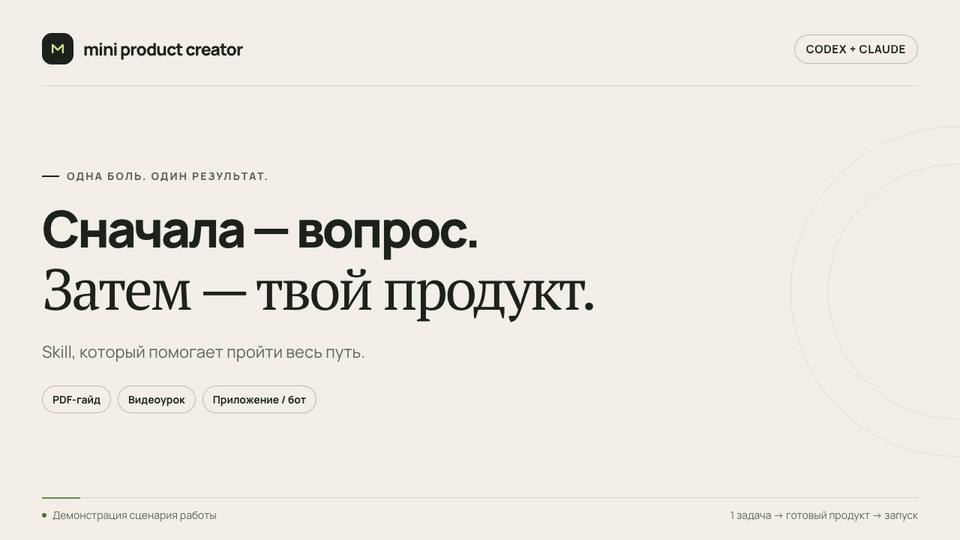

# Mini Product Creator

### От «что мне продавать?» до мини-продукта, который можно купить и получить.

Навык для **Codex и Claude**, который помогает эксперту или блогеру выбрать одну задачу аудитории, создать законченный продукт и подготовить его продажу: с оффером, оплатой, выдачей и размещением.

**Одна боль → один понятный результат → готовый товар.**



[Смотреть демонстрацию в видео — 26 секунд](assets/mini-product-creator-demo.mp4) · [Редактируемый проект HyperFrames](motion/mini-product-demo)

*Демонстрация сценария работы. Анимация показывает пример диалога и этапы навыка; реальный результат создаётся в вашей среде Codex или Claude.*

[Скачать навык](https://github.com/C0mrade530/mini-product-creator-skill/raw/refs/heads/main/downloads/mini-product-creator.zip) · [Полный комплект](https://github.com/C0mrade530/mini-product-creator-skill/raw/refs/heads/main/downloads/Mini-Product-Creator-комплект.zip) · [Начать без установки](prompts/mini-product-creator.txt)

## Сначала разберётся в вашей задаче

Необязательно приходить с готовой идеей. Навык задаёт по 1–3 вопроса за раз: об опыте, аудитории, её реальных проблемах, материалах и ресурсах. Если вы застряли, предложит несколько предметных вариантов.

Дальше проведёт по пути:

1. **Экспертность и аудитория.** Что вы умеете, кому можете помочь и на чём основан спрос.
2. **Одна задача и результат.** Какую конкретную работу человек хочет выполнить и как поймёт, что получилось.
3. **Формат и сборка.** Что покупатель получит, как пройдёт продукт и что потребуется от автора.
4. **Оффер и цена.** Понятная ценность, состав, условия и один следующий шаг для покупки.
5. **Оплата и выдача.** Подходящий платёжный маршрут, доступ после подтверждения и восстановление при сбое.
6. **Размещение и проверка.** Платформа или GitHub с хостингом, проверка доступного пути покупателя и список оставшихся действий.

Если информации об аудитории мало, навык подготовит план исследования и вопросы для интервью. Непроверенные предположения останутся гипотезами.

## Выберите форму результата

| Формат | Что помогает создать | Что делает автор |
| --- | --- | --- |
| **PDF-гайд** | Готовый PDF и исходник: инструкция, примеры, шаблоны и самопроверка | Передаёт знания, проверяет содержание |
| **Видеоурок** | Сценарий записи, пример, практику, материалы и упаковку готового видео | Записывает видео |
| **Приложение / Telegram-бот** | Работающее ядро: ввод → обработка → результат → получение, затем доступ и запуск | Даёт доступы и проверяет результат |

Формат подбирается под задачу. Шаблон, небольшой практикум, услуга или гибрид тоже подходят, если они дают нужный результат проще.

## Быстрый старт

### Без установки

Откройте [полный промпт](prompts/mini-product-creator.txt), скопируйте его целиком в новый чат Codex или Claude и добавьте:

> Я блогер / эксперт в [ниша]. Хочу создать мини-продукт, который можно купить и получить. Идеи пока нет. Начни с вопросов, предложи варианты и помоги всё собрать.

Для создания файлов, запуска приложения и проверки используйте среду с доступом к проекту и терминалу. Сам текст промпта инструменты и аккаунты не добавляет.

### Codex

Скопируйте папку [`skills/mini-product-creator`](skills/mini-product-creator) целиком, включая `references` и `agents`, в один из каталогов:

```text
~/.agents/skills/mini-product-creator/
```

или только в выбранный проект:

```text
<проект>/.agents/skills/mini-product-creator/
```

Затем вызовите `$mini-product-creator` или выберите навык через `/skills`. Если список не обновился, перезапустите Codex.

### Claude Code

Скопируйте ту же папку целиком в один из каталогов:

```text
~/.claude/skills/mini-product-creator/
```

или:

```text
<проект>/.claude/skills/mini-product-creator/
```

Вызовите `/mini-product-creator` и расскажите о задаче. Для Claude с поддержкой загрузки пользовательских навыков доступен отдельный [ZIP](downloads/mini-product-creator.zip).

[Подробная инструкция, примеры запросов и установка в Claude →](docs/START-HERE.md)

## Что останется у вас

В среде с нужными инструментами — сам продукт и его исходники, а также рабочие документы:

- **`PRODUCT.md`** — аудитория, задача, результат, состав, сроки, цена и основания решений.
- **`README.md`** — как пользоваться, запускать и размещать продукт.
- **`LAUNCH.md`** — оффер, экономика и план первого пилота.
- **`CHECKS.md`** — фактические проверки, ограничения и недостающие подключения.

В существующем проекте навык может использовать уже принятые документы. Для видео до получения записи будет готов комплект для съёмки; законченный урок появится после записи и проверки.

## От идеи до покупки — с реальными подключениями

Для самостоятельного сайта навык помогает выбрать и подключить **ЮKassa, Prodamus** или другой подходящий способ. Для цифровой продажи внутри Telegram учитывает требования **Telegram Stars**. Затем выстраивает цепочку «заказ → подтверждённый платёж → право на продукт → выдача → открытие → восстановление доступа».

Готовый файл в репозитории, работающий сайт и проверенная покупка — отдельные этапы. Навык указывает, какой из них действительно пройден.

Аккаунты продавца, реквизиты и хостинг предоставляет владелец. Секретные ключи вводятся в защищённые настройки или локальный env — их не нужно отправлять в чат и публиковать в GitHub. Реальные расходы требуют поручения владельца.

«За вечер» — ориентир для посильной первой версии. Исследование, запись видео и подключение платёжного аккаунта могут потребовать дополнительного времени. Навык помогает довести продукт до результата, но не обещает продажи или доход.

## На чём построен навык

JTBD, Customer Development, Lean Startup, проверка рискованных предположений, проектирование пути к результату и честная упаковка ценности. Методологии используются для принятия конкретных решений, а не для заполнения десятков таблиц.

[Методология, первичные источники и важные уточнения →](skills/mini-product-creator/references/sources.md)

---

**Начните с того, что уже знаете. Остальное навык поможет выяснить и собрать.**
